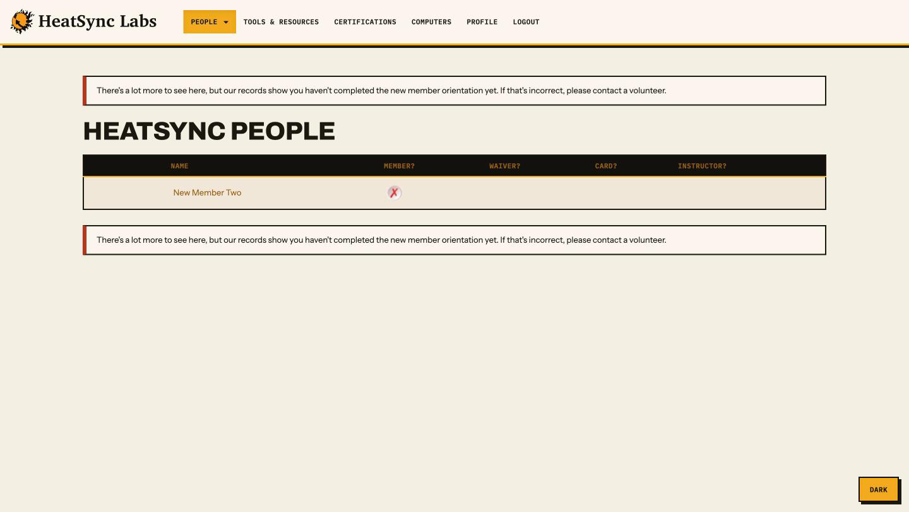

# Open Access Control Web Interface

Web software for managing a database of members in a collaborative grassroots workshop, and also controlling Arclight of 23b Hackerspace's Arduino access control system via Ethernet ( see: https://github.com/zyphlar/Open_Access_Control_Ethernet )

https://github.com/zyphlar/Open-Source-Access-Control-Web-Interface

Copyright Will Bradley, 2012-2024
Distributed under a Creative Commons Attribution 3.0 license http://creativecommons.org/licenses/by/3.0/

Contributions welcome! Simply send a pull request via Github.

## Documentation

How the site works, how to look after it and how to change it: **[docs/](docs/README.md)**,
starting with the [overview](docs/overview.md). Guides for door access, access cards,
files and waivers, environments and deploying, configuration, development and operations.

## This branch

HeatSync's production members app, brought off Rails 3.2. Now Ruby 3.3 / Rails 7.2 / PostgreSQL, Dockerized, and themed with GANTRY (light or dark, following the device until someone picks one). Same features (members, door logs, payments, certifications, audit log, member signup), current stack, plus a lab calendar and an analytics page.

## Staging and production

| Branch | Coolify app (project Critical Infra) | Address |
|---|---|---|
| `main` | `members-production` | https://members.heatsynclabs.org |
| `staging` | `members-staging` | https://staging.heatsynclabs.org |

A push to `main` deploys production; a push to `staging` deploys staging. Staging runs on a
fresh copy of last night's production data, its mail never leaves the server, and its door
buttons drive an emulator of the board's real firmware, never a real door. Production sends
every door action through door-api and keeps its files in the lab's own file store.

How to make a change, test it on staging and ship it, and how to undo one:
[docs/environments-and-deploying.md](docs/environments-and-deploying.md). Every setting:
[docs/configuration.md](docs/configuration.md).

## How the front end is built

* **One layout** (`app/views/layouts/application.html.erb`) for every page: header, main nav, the role menus (Treasurer, Admin), caution tape, footer.
* **Stylesheets** in `app/assets/stylesheets`, compiled with Dart Sass (`dartsass-sprockets`), so modern CSS works as written. `gantry_tokens.scss` is the GANTRY token set shared with heatsynclabs.org; everything else uses its variables, in cascade layers: `base`, `layout`, `components` (with `forms` and `tables`), `calendar`, `charts`, `pages` (and `pages/*.scss` per area).
* **ViewComponents** in `app/components` for repeated pieces: `PageHeaderComponent` (also sets the tab title), `StatTileComponent`, `ChipComponent`, `MemberBadgeComponent`, `AvatarComponent`, `DoorTileComponent`, `FormErrorsComponent`, `EmptyStateComponent`, `ChartCardComponent`, and the calendar's `Calendar::*` components. Icons are Lucide (`lucide_icon "name"`).
* **JavaScript** through import maps (`config/importmap.rb`), no Node build. Behavior is in Stimulus controllers (`app/javascript/controllers`). Turbo is used only for frames (the calendar card loads after the page); Turbo Drive is off, so jquery_ujs still handles sign out and delete links (`app/assets/javascripts/legacy.js`).
* **Charts** are Chartkick and Chart.js (`app/javascript/charts.js`, loaded only on pages with a chart). Each theme has its own palette, checked for colour-blind separation.

## Lab calendar

`/calendar` shows the lab's public Google Calendar as a month grid, a week or a list, with the same categories and colours as heatsynclabs.org. `Calendar::WeekComponent` is the "this week" card; drop it into a page with `<%= render "calendar/week_frame" %>`, which loads it in a Turbo Frame so the page never waits on Google.

`LabCalendar` (`app/models/lab_calendar*`) reads the public ICS feed on the server, keeps a fresh copy for 15 minutes and the last good copy for a week, and expands repeating events with `icalendar-recurrence`. Set `GOOGLE_CALENDAR_ICS_URL` to read a different calendar. No API key is needed.

## Analytics

`/analytics` is for any signed-in member and linked in the main nav: members, door use and the calendar, as counts only, plus dues for treasurers and admins. The queries are in `app/queries/analytics`, one small class per subject, grouped in lab time with `groupdate`, and cached for 10 minutes per period.

## Run locally (Docker)

`docker compose up`, then `docker compose exec members_web bundle exec rake db:setup`, then
http://localhost:3000 (sign in with the admin in `db/seeds.rb`). Keep
`DOOR_ACCESS_URL=http://127.0.0.1:9` so nothing on your laptop can reach a real door.
Details, the tests and the door emulator: [docs/development.md](docs/development.md).

## Configuration

All settings are environment variables (Coolify on the lab's server); none are secrets in
this repository. The full list, with what each does: [docs/configuration.md](docs/configuration.md).
Locally, the Docker setup uses safe defaults.

## Manual setup

* Install Imagemagick (for Paperclip / image uploads)
* Install arp-scan (for LAN Mac address scanning)
* Load into a Ruby 3.3 / Rails 7.2 environment
* Copy config/config.yml.example to config/config.yml and edit appropriately
* Copy config/database.yml.example to config/database.yml and edit appropriately
* Set the `S3_*` settings for an S3-compatible file store (Amazon S3, or a self-hosted one such as Garage): see docs/files-and-waivers.md
* Copy config/initializers/secret_token.rb.example to config/initializers/secret_token.rb and edit appropriately
* See/edit db/seeds.rb for the initial admin account info.
* Run bundle install, rake db:migrate, rake db:seed, etc.
